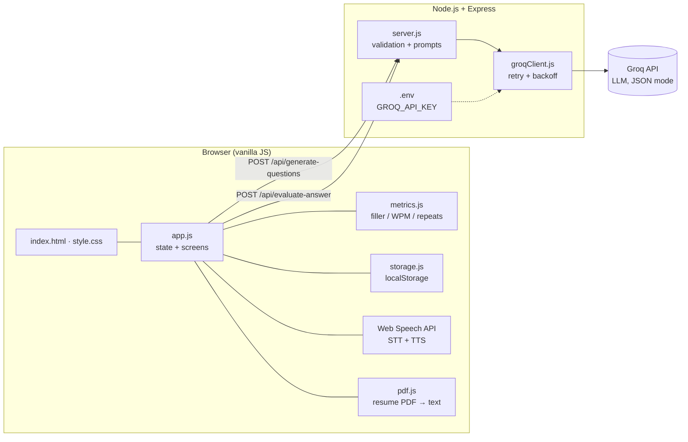
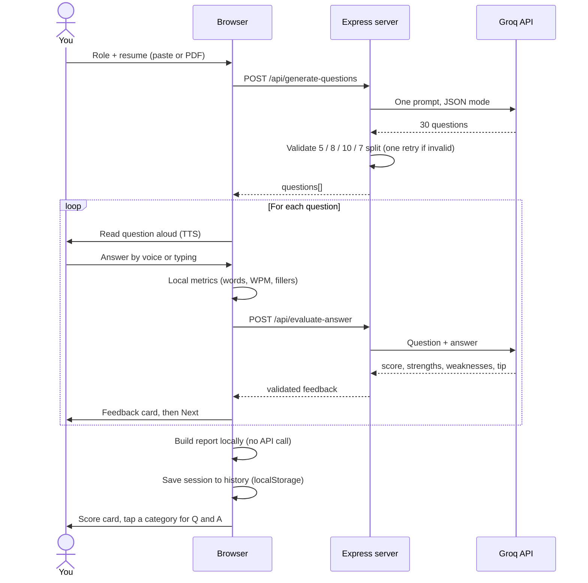
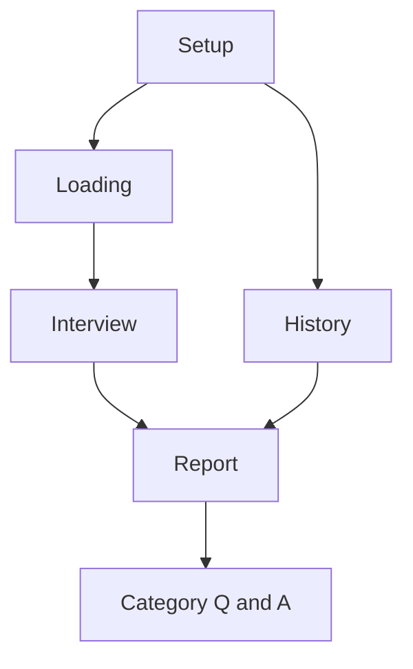

# 🎙️ MockMate AI

**A voice-based mock interview coach.** Give it a job role and your resume — it asks 30 tailored questions out loud, listens to your answers, scores each one with AI, and ends with a detailed report you can drill into.

`Node.js` · `Express` · `Vanilla JavaScript` · `Groq API` · `Web Speech API` · `localStorage`

---

## ✨ Features

- **30 personalised questions in one API call** — 5 Personal, 8 Resume-based, 10 Fundamentals, 7 Problem-Solving. The split is validated on the server; an invalid response triggers one corrective retry.
- **Resume input two ways** — paste text or upload a PDF (parsed in the browser with pdf.js; the file never leaves your machine).
- **Voice in, voice out** — questions are read aloud (SpeechSynthesis) and answers are captured by microphone (SpeechRecognition), with typing as a fallback.
- **Per-answer AI feedback** — score out of 10, strengths, weaknesses, an improvement tip, and the points an ideal answer would cover.
- **Instant local metrics (no API)** — word count, words-per-minute, filler words (`um`, `like`, `basically`…) and repeated words.
- **Locked answers** — once submitted an answer can't be edited; *Previous* is view-only.
- **Resilient by design** — *Retry evaluation* or *Continue without AI feedback* if the API fails; never a dead end.
- **Score card you can drill into** — tap any of the four categories to see every question in it, your own answer, and the AI feedback.
- **Session history** — every interview (including ones ended early) is saved in the browser and can be reopened later.
- **End early** — stop at question 11 and get a report for just the questions you answered.
- **Resume an unfinished session** after a refresh or closed tab.

---

## 🏗️ Architecture



The API key lives **only** on the server. The browser never sees it, and the resume's raw text is never persisted.

---

## 🔄 How an interview runs



### Screens



- **Setup** → enter role and resume, generate questions
- **Interview** → answer one question at a time; *End early* or *Finish* opens the report
- **Report** → score card; tap a category to see its questions and your answers
- **History** → every past session (including incomplete ones), newest first
- Exiting mid-interview keeps your answers in history as an *Incomplete* session

---

## 🧰 Tech stack

| Layer | Technology |
|---|---|
| Frontend | HTML, CSS, vanilla JavaScript — no framework, no build step |
| Backend | Node.js, Express |
| AI | Groq API — chat completions in JSON mode |
| Voice input | Web Speech API — `SpeechRecognition` |
| Voice output | Web Speech API — `SpeechSynthesis` |
| PDF parsing | pdf.js 3.11.174 (client-side, via CDN) |
| Storage | Browser `localStorage` (active session + history) |

---

## 📁 Project structure

```
mockmate-ai/
├── server.js          # Express app: static files + the two API routes
├── groqClient.js      # Groq wrapper: retry with backoff on 429 / 5xx
├── package.json
├── .env.example       # Template for your .env
├── .gitignore
└── public/
    ├── index.html     # All screens: setup, loading, interview, report, history
    ├── style.css      # Styling (dark navy + amber theme)
    ├── app.js         # Frontend state and logic
    ├── metrics.js     # Local answer analysis, no API calls
    └── storage.js     # localStorage session + history
```

---

## 🔌 API reference

### `POST /api/generate-questions`

| | |
|---|---|
| **Body** | `{ "role": string, "resume": string }` |
| **Limits** | role ≤ 100 chars · resume 30–6000 chars |
| **Success** | `200 { "questions": [{ "id", "category", "text" }] }` — exactly 30 |
| **Errors** | `400` invalid input · `429` rate limited · `502` model returned an invalid set twice |

Categories are `personal`, `resume`, `fundamentals`, `problem_solving`. For technical roles the 7 problem-solving questions are standalone DSA problems; questions that lean on the candidate's resume are rejected and regenerated.

### `POST /api/evaluate-answer`

| | |
|---|---|
| **Body** | `{ "role", "category", "question", "answer" }` |
| **Success** | `200 { "feedback": { "score", "strengths", "weaknesses", "improvement", "idealAnswerPoints" } }` |
| **Errors** | `400` invalid input · `429` rate limited · `5xx` upstream failure |

Malformed JSON bodies return a clean `400` and oversized bodies a `413`, both as JSON.

---

## 🚀 Getting started

**Prerequisites:** Node.js 18+, a free [Groq API key](https://console.groq.com), and Chrome or Edge for voice input.

```bash
# 1. Clone and install
git clone https://github.com/<your-username>/mockmate-ai.git
cd mockmate-ai
npm install

# 2. Configure
cp .env.example .env
#    then open .env and set GROQ_API_KEY

# 3. Run
npm start
```

Open **http://localhost:3000**.

### Environment variables

| Variable | Description | Example |
|---|---|---|
| `GROQ_API_KEY` | Your Groq key (required) | `gsk_...` |
| `GROQ_MODEL` | Model available on your account | `openai/gpt-oss-120b` |
| `PORT` | Server port (optional) | `3000` |

> Model availability differs per Groq account. If you get a "model does not exist" error, list what you can use at `console.groq.com/docs/models` and update `GROQ_MODEL` — no code change needed.

---

## 🧪 Dev test mode

Answering 30 questions by hand for every test is slow. Open:

```
http://localhost:3000/?devmode=true
```

A striped banner appears with **Auto-run entire interview**. It fills canned answers but still makes **real** calls to `/api/evaluate-answer`, so a full run finishes in a couple of minutes. It only activates on `localhost` / `127.0.0.1`.

### Manual checklist

- [ ] Full session → report averages are correct
- [ ] Refresh mid-interview → resume prompt restores progress
- [ ] Mic permission denied → friendly message, typing still works
- [ ] Firefox → mic hidden, typing-only flow works
- [ ] Stop the server mid-answer → *Retry* / *Continue without feedback* appear
- [ ] Exit mid-way → session appears in history as *Incomplete*
- [ ] Tap each report category → questions and answers show correctly
- [ ] Two interviews → both listed in history, newest first

---

## 🔒 Privacy & security

- The Groq API key exists only in the server's `.env` and is never sent to the browser.
- The resume text is used for one request and **never written to `localStorage`**. Only the role, questions, your answers, metrics and feedback are stored.
- There are no accounts and no database. History lives in your browser's `localStorage`, so it is private to that browser and not available on other devices.
- All user text is rendered with `textContent`, never `innerHTML`.

---

## ⚠️ Known limitations

- Voice recognition relies on the Web Speech API, which works best in **Chrome and Edge**.
- History is per browser; clearing site data deletes it (the 20 most recent sessions are kept).
- Answer quality scores come from an LLM and are guidance, not a verdict.
- Free-tier Groq limits apply; the server retries with backoff and then shows a friendly message.

---

## 🛣️ Roadmap

- [ ] Delete a single history entry
- [ ] Export a report as PDF
- [ ] Progress trends across sessions
- [ ] Difficulty levels and a custom question count
- [ ] Optional accounts and a database for cross-device history

---

## 🩺 Troubleshooting

| Problem | Fix |
|---|---|
| `Cannot find module 'express'` | Run `npm install` |
| `GROQ_API_KEY is not set` | Copy `.env.example` to `.env` and add your key |
| Model does not exist / no access | Update `GROQ_MODEL` (see above) |
| PDF upload fails | pdf.js loads from a CDN — check your connection or paste the text |
| Port already in use | Set `PORT=3001` in `.env` |
| UI looks outdated after an update | Hard refresh with `Ctrl+Shift+R` |
| `Unexpected token '<'` on evaluate | Restart the server after changing `server.js` |